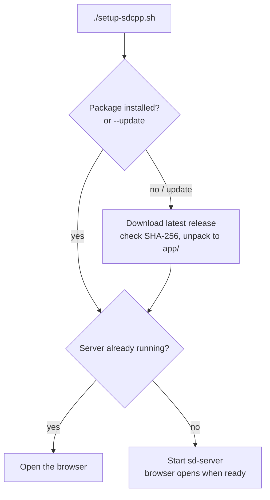

# stable-diffusion.cpp Server

`sd-server` provides a Web UI for image and video generation, model management,
and HTTP APIs. Download or build the server before starting; see the
[build guide](../../docs/build.md) and [frontend build instructions](#build-with-frontend).

- [Web UI](#web-ui): ready-built packages, one-script Linux setup, starting the server, getting models, and generating.
- [Model management](#model-management): model directories, recipes, and startup models.
- [Server configuration](#server-configuration): launcher settings, network, logging, and help.
- [API](#api): native and compatibility endpoints.
- [Frontend development](#frontend-development): build or customize the Web UI.

Inference settings follow this priority: request fields, explicit server startup
options, model recipe presets, then [library defaults](../../docs/guides/c_api.md#keys).
Omitted request fields retain the configured override. In native JSON requests,
`null` clears an optional inference field so the library selects its value;
`0`, `false`, empty strings and empty numeric arrays are explicit values.
Capability `defaults` and `defaults_by_mode` contain configured overrides, with
`null` for optional settings left to the library. Effective settings are returned
in generation metadata. Output formats, queue limits and listen addresses keep
server-local defaults.

## Web UI

### Ready-built packages

Running the **Studio release** workflow by hand (Actions tab, pick `master`) publishes a
`studio-<date>-<commit>` release on the
[releases page](https://github.com/forevion/forevion-sdcpp/releases) with builds that
include the Web UI. Each package runs on any x86-64 CPU and picks the fastest code path
(AVX2, AVX-512, ...) when it starts; the CUDA package also uses an NVIDIA GPU:

| Package | Runs on | Start |
| --- | --- | --- |
| `sdcpp-studio-windows-x64.zip` | Windows 10/11 | Unzip, double-click `start-studio.bat` |
| `sdcpp-studio-linux-x64.tar.gz` | glibc 2.35+ (Ubuntu 22.04+, Zorin OS 17+, Debian 12+) | `./setup-sdcpp.sh` (also inside the archive) |
| `sdcpp-studio-linux-x64-cuda.tar.gz` | The same Linux systems with an NVIDIA GPU from Turing (T4, RTX 20) to Blackwell (RTX 50, RTX PRO 6000) and NVIDIA driver 575+ | `./setup-sdcpp.sh` picks it when `nvidia-smi` finds a GPU |

The CUDA package bundles the CUDA 12.8 runtime and cuBLAS, so only the NVIDIA driver is
needed. A workflow run with **Publish** turned off only builds the packages and keeps
them as workflow artifacts.

`SHA256SUMS.txt` in each release lists the checksums.

### Quick start on Linux

On Debian/Ubuntu-based systems (for example Zorin OS), one script installs and starts
everything. Put it in an empty folder and run it:

```sh
mkdir -p ~/sdcpp && cd ~/sdcpp
curl -fLO https://raw.githubusercontent.com/forevion/forevion-sdcpp/develop/scripts/setup-sdcpp.sh
chmod +x setup-sdcpp.sh
./setup-sdcpp.sh
```

The first run downloads the latest release, checks its SHA-256, unpacks it into `app/`,
installs the OpenMP runtime with apt if the system lacks it, starts the server and opens
the browser. Later runs start it straight away; `--update` installs a newer release when
there is one.



The installed release (`sd-server`, `sd-cli`, libraries) goes to `app/` next to the
script, and `studio-settings.json` there remembers the models, inputs and outputs folders
you choose in the browser on the first start.

**NVIDIA GPU.** `--gpu auto` (the default) uses CUDA when `nvidia-smi` finds an NVIDIA
GPU: it installs the CUDA package instead of the CPU one and starts the server with
automatic placement, so weights go to the GPU's memory first and spill into RAM when they
do not fit. `--gpu cpu` forces the CPU build and `--gpu cuda` insists on the GPU. With
`--from-source`, a CUDA build needs the CUDA toolkit 12.x (`nvcc`) and compiles for the
installed GPU only, which takes 15-40 minutes the first time.

Options: `--update` installs the latest release, `--setup-only` installs without
starting, `--port N` changes the port, `--lan` lets other devices on the network connect,
`--threads N` overrides the thread count, `--gpu auto|cuda|cpu` chooses the build and
`--no-browser` skips opening the browser. Run with `--help` for the full list.

**On a rented cloud GPU.** Pick a Linux (Ubuntu 22.04 or newer) machine with an NVIDIA
GPU and its driver; most GPU images already have it (`nvidia-smi` shows the GPU). Run the
script there with `--no-browser`, then reach the Web UI through an SSH tunnel from your own
computer, so the server is never exposed to the internet:

```sh
ssh -L 1234:127.0.0.1:1234 user@gpu-machine
```

Then open <http://127.0.0.1:1234> on your computer. The badge at the bottom of the
sidebar shows **GPU** (green) when the model runs on the GPU, **GPU** in amber when part
of it had to stay in RAM, and **CPU** otherwise; hover it for the devices and their
memory. A CUDA build that finds no GPU shows **No GPU** and a warning on Create. The Queue
and the Gallery show which device each job ran on. Through the tunnel the folder
browser shows the cloud machine's folders. Rough GPU memory needs: Wan 5B and the 14B
Q4_K_M models fit in 24 GB; Wan 2.2 A14B (two experts) and Kandinsky 6 Pro work best with
48 GB or more. Do not use `--lan` on a public machine: the server has no login.

Cloud GPU containers (RunPod, Vast.ai, ...) usually log you in as `root` without `sudo`;
the script then installs missing packages with `apt-get` directly.

**RunPod, step by step.** Only the volume survives when a pod is removed, so keep
everything on it:

1. Create a **network volume** (150 GB is enough for several models; billed per GB-month
   whether or not a pod runs) in the region where you want GPUs.
2. Deploy a pod on it with an Ubuntu 22.04+ image that has CUDA 12.8 or newer (for example
   RunPod's PyTorch template), the volume mounted at `/workspace`, and **SSH over exposed
   TCP** turned on (the simpler proxied SSH cannot forward ports).
3. In the pod's terminal:

   ```sh
   mkdir -p /workspace/sdcpp && cd /workspace/sdcpp
   curl -fLO https://raw.githubusercontent.com/forevion/forevion-sdcpp/develop/scripts/setup-sdcpp.sh
   chmod +x setup-sdcpp.sh
   ./setup-sdcpp.sh --no-browser
   ```

4. On your computer, open the tunnel with the SSH command RunPod shows for the exposed TCP
   port, adding `-L 1234:127.0.0.1:1234`, and open <http://127.0.0.1:1234>.
5. On the first start choose `/workspace/models`, `/workspace/inputs` and
   `/workspace/outputs` as the folders.

Next time, deploy a pod on the same volume and run `/workspace/sdcpp/setup-sdcpp.sh
--no-browser` again: the app, the folders setting and the models are already there.
Terminate the pod when you are done; a stopped pod keeps charging for its own disk.

**Building from source.** `--from-source` clones the `develop` branch into
`stable-diffusion.cpp/` and builds it for this exact CPU instead: it installs Git, CMake,
Ninja and the compiler with apt, downloads Node.js and pnpm into `tools/` for the Web UI,
and caps parallel compile jobs at one per 2 GB of free RAM. The build goes to `build/`
and takes several minutes the first time; later runs rebuild only when the source
changed (`--update` pulls first, `--rebuild` forces it). The script also builds from
source on non-x86 machines, when no release exists yet, and when it is run from inside a
checkout (`scripts/setup-sdcpp.sh`, building into `build-linux/` and using the checkout's
`models/` and `output/`).

### Start the server

From the repository root, start the launcher. It finds the server executable
and starts it with `--settings-file studio-settings.json` next to the launcher:

**Windows (PowerShell)**

```powershell
.\start-server.bat
```

You can also double-click `start-server.bat` in File Explorer to start the
server. Keep the console window open while using the Web UI.

**Linux/macOS**

```sh
sh ./start-server.sh
```

On a Linux desktop you can also double-click `start-server.sh` (choose **Run** if the
file manager asks). When it is not started from a terminal, it opens one
(GNOME Terminal, Konsole, xfce4-terminal, xterm and others) so the log stays visible,
and keeps the window open after the server stops.

To start the executable directly instead, run from the build directory:

**Windows (PowerShell)**

```powershell
.in\Release\sd-server.exe --model-dir ..\models
```

**Linux/macOS**

```sh
./bin/sd-server --model-dir ../models
```

The Windows path above is for a Visual Studio Release build. Adjust the path
for another build configuration or an extracted release archive. Open
<http://127.0.0.1:1234/> after the server starts, and keep the server running
while using the browser.

### Choose your folders

On the first start the browser shows **Welcome to Forevion Studio** and asks for three
folders before anything else:

- **Models**: model files. Pick the folder that already holds your models to use them;
  downloads go into `diffusion_models/`, `text_encoders/`, `vae/`, ... inside it.
- **Inputs**: start images, reference images, audio and control videos you add on Create.
- **Outputs**: finished images and videos (the Gallery).

Type a full path or click **Browse…** to pick a folder (with **Create folder**); missing
folders are created. The choice is saved in `studio-settings.json` next to the launcher
and applied at once, without a restart. Nothing is created next to the app until the
folders are chosen. Change them later in **Models → Settings → Folders**. The screen
appears again if a saved folder no longer exists. Browsing only works in a browser on the
computer that runs the server; from another device, type the paths.

### Get models

**Models** shows one card per model with its state (Not downloaded, Downloading,
Partly downloaded, Needs setup, Ready, Missing files), what it can do (text to video,
image to video, sound, lip sync, ...) and one button for the next step:

- **Download** saves the model's files into their category folders (`diffusion_models/`,
  `text_encoders/`, `vae/`, ...) with progress and time left. **Stop** keeps the
  downloaded part, so **Resume** continues from there.
- **Set up** opens the setup guide for a downloaded model: it says which file goes into
  which input and which settings the model needs, and creates a *variant* (a saved
  combination of files and defaults) for you to check and save.
- **Use** opens **Create** with that model selected.

**Details** shows a model's description, its variants (edit, copy, delete), its files
(delete the downloaded files after a confirmation that lists them and says which other
models use them) and, under **Advanced**, the raw download entry.

**Add your own model** is a short wizard: pick the model type, choose a file for each
input it needs (it lists what is still missing), set the defaults and save.

**Settings** holds:

- **Folders**: the models, inputs and outputs folders (see [Choose your folders](#choose-your-folders)).
- **Storage**: every model file (LoRAs included) with its size, the variants that use
  it and the free disk space; files can be deleted after a confirmation.
- **Backup and restore**: save or load all variants and added downloads as one JSON file.
- **Model list**: where the online model list comes from (**Released (master)**,
  **Latest (develop)**, another address, or off), refresh it, rescan the model folders,
  add a single file from a link (Hugging Face links get their size and SHA-256
  automatically) or a new download entry.

The model list is plain data (`downloads.json`), so adding or changing a model entry needs
no rebuild or restart: edit `downloads.json` on GitHub and click **Refresh model list**.
Choose **Latest (develop)** to get such edits before they are released.

The built-in list has FastWan 2.2 5B, Wan 2.2 TI2V 5B, Wan 2.2 T2V / I2V A14B, Wan 2.2 S2V
14B, Wan 2.1 T2V 1.3B / 14B, Wan 2.1 I2V 14B (480p and 720p), Wan 2.1 FLF2V 14B, Wan 2.1
VACE 1.3B / 14B and Kandinsky 6.0 Lite. The 14B models use Q4_K_M files (about 10 GB each)
so they fit in 32 GB of RAM; on a CPU they take tens of minutes for a short clip.

Downloads never create variants by themselves. Files placed by hand in the category
folders (see [Model directories](#model-directories)) work the same way after a rescan.

### Create images and videos

1. Open **Create** and pick a model from the **Model** list: ready variants first, then
   your variants with missing files, then other model types whose files you pick
   yourself. **Model files** shows a picker for every input of the chosen variant;
   **Save as variant** stores a changed combination.
2. Pick what to make under **What to make**. Every task is listed; the ones the chosen
   model cannot do are dashed. Clicking one says why and lists the ready models that can
   (with a **Use** button) and the model types to download or add. The tasks are text to
   video, image to video, speech to video (lip sync), character to video (keep a person or
   object from a picture, for example with Wan 2.1 VACE), video to video, text to image,
   image to image, image edit, and text to audio, which no stable-diffusion.cpp model can
   do yet.
3. Add the inputs the task needs under **Inputs**: a start image (optional for some
   models, required for image to video), an end frame, reference images, an audio clip
   (any format the browser can decode, sent as WAV, up to 30 s) or a control video
   (its frames are extracted in the browser). Image to image also has a **Strength**
   slider. A message says which required input is still missing.
4. Type a prompt and pick **Shape**, **Size** and, for video, **Length**.
5. Click **Generate** (or press Ctrl+Enter). The preview shows the current stage, step,
   elapsed time and time left; **Stop** cancels it. More jobs wait in the **Queue**.
6. The result appears in the preview with **Reuse**, **Save**, **Delete** and close
   buttons, and in the **Recent** strip.

The inputs of each job are kept in the inputs folder (one file per distinct image or
clip), and **Reuse** puts them back into the form together with the prompt and settings.

**Command** shows what the job runs: the matching `sd-cli` command (PowerShell or
bash, depending on the server's model folder), the JSON request for
`/sdcpp/v1/vid_gen` or `img_gen` (images left out) and a `curl` line to send it.

**LoRAs** (folded, shown when the model's recipe allows LoRAs) adds one or more LoRA
files from the `loras/` (or `Lora/`) folder of the model folders, each with a
**Strength** slider. Models with separate high-noise and low-noise experts (Wan 2.2
A14B) also choose which expert a LoRA changes: **Both**, **High noise** or **Low noise**.
A note warns when a LoRA's file name points at another model family (for example a
Wan 14B LoRA on Wan 2.2 5B). **Add LoRA from a link** downloads a LoRA file from a
link into `loras/`. LoRA choices are kept per model, are saved with each result
(`lora` in the sidecar), are put back by **Reuse** and are listed in the Gallery
details. The `sd-cli` command adds them as `<lora:file:strength>` prompt tags with
`--lora-model-dir`.

**Advanced** holds the negative prompt, steps, CFG, FPS and a fixed seed; empty fields
use the model's defaults. **New** clears the prompt, the inputs, these overrides and
the preview.

Models that make sound (they have an audio VAE) are saved as AVI with the soundtrack,
because WebM output is silent. The server also saves a silent WebM preview for the
browser; the saved AVI keeps the sound. Results with sound show a ♪ badge.

The **Gallery** lists every saved result with search and Video/Image filters. Its
prompt bar at the bottom starts a text-to-video or text-to-image job with the current
Create settings, and running jobs show as placeholder tiles. Click a tile to view it
full size with its settings, reuse them, save the file or delete it.

### Server log

The terminal shows each job as it runs: when it is queued (model, size, frames, steps
and prompt), started, each stage and sampling step, when it is saved, and whether it
finished, failed or was cancelled. Failed API requests are logged with their HTTP
status and error message.

### DGL editor

Open the Web UI using the local server address and select **Scripts** in the sidebar.
The workspace follows the server's `--listen-ip` setting. The default `127.0.0.1`
limits access to the server machine. When the server listens on a LAN interface, open
the Web UI using the server's LAN IP and port to use it from another device.
Select a saved script or choose **New**. **Duplicate** saves a copy of the
current editor text under a new name. Edit **File name** before saving to save
under a different name. **Run** submits the editor text to the generation queue,
so you can run unsaved edits. The results panel shows text, scalar and tensor
information and returned encoded media. PNG appears as an image, WebM as a
video player, and AVI as a download. WebM encoding is silent; use AVI for
a PCM16 soundtrack.

Use `image::encode` or `video::encode` and return their `{data, mime_type}`
dicts, either directly or as named fields of the root dict. To save the same
encoded output, call `media::save("output/cover.png", cover)` before returning
it. Saving is optional. The job result contains the same encoded bytes, and
polling returns them without re-encoding.

The server can serve files under `input/`, `output/` and `assets/` for upstream
editors' inline media previews; the Scripts page does not show them yet. Start the
server with `--no-media-view` to turn that file access off.

DGL jobs share an execution context for the lifetime of the server. Compatible
scripts can reuse loaded model components across runs. The context can release
idle weights under memory pressure.

Scripts are listed and saved in the server's working directory under
`dgl/` by default. Use `--dgl-dir` to select another directory. Script paths
are relative to the server's working directory. Model files and their
dependencies must reside under one of the configured `--model-dir` roots.
Write results under `output/` in the working directory. For example,
`image::save("output/result.png", image)` saves a PNG.

## Model management

### Model directories

Repeat `--model-dir` to share multiple model directories, including an existing
SD WebUI model directory. Run these examples from the build directory:

**Windows (PowerShell)**

```powershell
.\bin\Release\sd-server.exe --model-dir ..\models --model-dir D:\stable-diffusion-webui\models
```

**Linux/macOS**

```sh
./bin/sd-server --model-dir ../models --model-dir /data/stable-diffusion-webui/models
```

With no `--model-dir`, the server uses `./models`. Explicit roots replace that
default and are scanned in argument order. Duplicate canonical roots and file
paths are scanned once. Every root can contain a `recipes/` directory.
Directory names are matched case-insensitively on all platforms:

| Category | Directory names |
| --- | --- |
| Checkpoints | `checkpoints`, `Stable-diffusion` |
| VAE | `vae`, `VAE` |
| LoRA | `loras`, `Lora` |
| ControlNet | `controlnet`, `ControlNet` |

Other categories keep their existing directory names. Classification uses only
the containing directory: `*.vae.safetensors`, `*.vae.ckpt`, and similar names
inside `checkpoints/` or `Stable-diffusion/` remain checkpoints.

Place model files in category directories, for example:

```text
models/
  checkpoints/
  diffusion_models/
  text_encoders/
  tokenizers/
  vae/
  clip_vision/
  loras/
  recipes/
    my-flux.json
```

Subdirectories within a model category are supported. Use **Refresh files &
recipes** after adding files or changing recipes. Scanning lists file names
without loading model weights. Category membership does not guarantee
compatibility; the model loader performs the final compatibility check.
Symlinks resolving outside the model directory are rejected. Dropdown labels
omit the category prefix while retaining subdirectory names. Identical display
paths are displayed as full file paths, with source directories before the
filename instead of a hash suffix. The same applies to duplicate LoRA paths. File IDs include a
root qualifier for additional roots; clients should use the returned IDs.
Empty optional categories do not display missing-file hints.

Place Tiny AutoEncoder (TAE) files in `vae/` and select them in the **TAE**
slot. The legacy `vae_approx/` directory is also scanned for TAE selections.

LoRAs are discovered automatically in both `loras/` and `Lora/` under every
model root. Use `--lora-model-dir` to replace automatic discovery with one
explicit LoRA directory. Duplicate names remain separate selectable entries. The LoRA selectors support
searching by name or path with the same keyboard controls as model selectors.

### Recipes

A recipe describes a model's components, supported capabilities, and generation
defaults. See the [model guides](../../docs/models/README.md) for compatible
recipes and weights. Text encoder labels in the selectors identify the expected
encoder family and size.

#### Built-in and user recipes

Built-in recipes are embedded in the binary from [recipes/](recipes/), with one JSON file per recipe. Adding or
editing a built-in requires rebuilding the server. User recipes are read from
`<model-dir>/recipes/*.json`. A valid user recipe with the same ID replaces
the entire built-in recipe. Across roots, the first valid user recipe wins;
overrides are logged. Duplicate user IDs within one root are rejected; invalid
recipes are reported without removing a valid recipe from another root or the
built-in version. Slots need only `id` and
`required`; the server supplies labels and search directories. Use `label`
only when a recipe needs a more specific display name.

Built-in additions and changes must follow the [recipe policy](recipes/README.md).
Split recipes by task weights or added capabilities, not by style or acceleration
LoRAs. Quantizations, file formats and compatible layer-count variants share a
recipe. Native encoders, projectors and connectors stay in the model's recipe.
Community editing recipes require selecting the matching LoRA separately; a
recipe does not enable it automatically.

#### Generation defaults and controls

See [generation defaults and sources](recipes/defaults.md) for the selected
publisher recommendations and reference-code defaults, with step defaults capped
at 20. Recipes link to the
original publisher's Hugging Face repository where one is available. DiT
recipes default to Euler, except for models requiring a specialized sampler.

Recipes use `features` to enable specialized controls and `disabled_features`
to turn off shared defaults. Disabled features take precedence. The UI hides
unsupported fields, empty sections and irrelevant sampler/cache options, and
omits hidden values from generation requests. See the
[feature declarations](api.md#recipe-feature-declarations) for the defaults
and complete list of supported names.

#### VAE and TAE

Compatible recipes offer a TAE slot alongside VAE. When the checkpoint does not
bundle a VAE, select at least one of VAE or TAE. The Models panel shows a reminder
below the model selectors until this requirement is met. A selected TAE is used for
encoding and decoding, including when a full VAE is also selected; use complete,
model-compatible TAE weights rather than decoder-only preview weights. Qwen
Image 2.1 uses the same recipe for its full VAE and TAEQI2.1 alternatives.

### Models loaded at startup

You can pass the same model-loading arguments used by `sd-cli` to `sd-server`.
Explicit model paths can be outside `--model-dir`. A startup model directory
includes the dependencies inside that directory. A startup shard index also
permits the shards it names within the index directory. Native generation accepts
LoRAs from `--lora-model-dir` and upscalers from `--hires-upscalers-dir`.
For example, run this Z-Image Turbo configuration from the build directory:

**Windows (PowerShell)**

```powershell
.\bin\Release\sd-server.exe `
  --model-dir ..\models `
  --diffusion-model ..\models\diffusion_models\z_image_turbo_bf16.safetensors `
  --vae ..\models\vae\ae.sft `
  --llm ..\models\text_encoders\qwen_3_4b.safetensors `
  --offload-to-cpu `
  -v `
  --cfg-scale 1.0
```

**Linux/macOS**

```sh
./bin/sd-server \
  --model-dir ../models \
  --diffusion-model ../models/diffusion_models/z_image_turbo_bf16.safetensors \
  --vae ../models/vae/ae.sft \
  --llm ../models/text_encoders/qwen_3_4b.safetensors \
  --offload-to-cpu \
  -v \
  --cfg-scale 1.0
```

`--diffusion-model`, `--vae`, and `--llm` select the model components.
`--offload-to-cpu` keeps weights in RAM when possible to reduce VRAM pressure,
`-v` enables verbose logging, and `--cfg-scale 1.0` sets the default CFG scale.

The model specified on the command line is the initial model for API clients.
Its components load when needed. The UI offers **Current server model** with
generation defaults and controls for the active configuration. Generating with
a catalog recipe makes that selection the current model.

#### Identity inputs

PhotoMaker and PuLID use the **DGL editor**. Prepare the inputs using the
[PhotoMaker](../../docs/models/photo_maker.md) or [PuLID](../../docs/models/pulid.md)
guide, then set model and identity-input paths in the corresponding script.
The former identity-input startup arguments have been removed. Scripts read
their own inputs under the server's file-access rules.

#### Sharded checkpoints

For a checkpoint loaded from a complete repository directory, pass its model
loading arguments when starting `sd-server`, as in the model's CLI example.
Keep the index, tokenizer, and all shards together. The browser then uses
**Current server model** for that repository. Select the repository
using the startup option so the model loader can resolve all its shards.

### Switching models

Choose a recipe and component files for the next generation. A queued job that
specifies a recipe makes it the current model when it starts. Later requests
without a recipe use the current model. The server shares one execution context
with the DGL editor and reuses matching model components within its startup
memory budgets. A load failure is reported on the job that requested the model.

See [the API reference](api.md#model-management) for recipe fields, supported
slots, management endpoints, and compatibility behavior.

### Limitations

Tiny SD/Tiny SD2 and Diffusers LCM directories must first be
converted into single-file checkpoints for the file catalog. LCM checkpoints
and LoRAs use the matching SD family recipe; select LCM sampling and adjust
steps/CFG for the chosen weights.
Metadata inspection, conversion, standalone upscaling and ADetailer are CLI
workflows rather than model-loading recipes. ESRGAN and LTX latent upscalers
are selected through generation upscaling settings with `--hires-upscalers-dir`;
textual inversion uses the startup `--embd-dir` option.

SVD is not available through the current server pipeline.

## Server configuration

Reference images, masks, audio, first/last video frames, and generation options
such as upscaling are supplied with generation requests. Hardware and memory
options are startup arguments and apply to subsequent model loads.

### Launcher settings

Both source checkouts and binary release archives include `start-server.bat`
and `start-server.sh`. The launchers search for the server beside the script,
then in `bin/Release/`, `bin/`, `build/bin/Release/`, and `build/bin/`, in that order.
They print the resolved command and forward the server's exit code.

#### Custom executable

For a different build directory, set `SD_SERVER_PATH` to the executable path.
Run from the repository root:

**Windows (PowerShell)**

```powershell
$env:SD_SERVER_PATH = ".\build_vulkan\bin\Release\sd-server.exe"
.\start-server.bat --listen-port 8080
```

**Linux/macOS**

```sh
SD_SERVER_PATH="./build_vulkan/bin/sd-server" sh ./start-server.sh --listen-port 8080
```

`SD_SERVER_PATH` inherits the environment value by default. Leave it empty for
automatic discovery. An explicit invalid path does not fall back to another build.

#### Local configuration

Keep personal settings in a file beside the launchers: `start-server.local.bat`
on Windows or `start-server.local.sh` on Linux/macOS. These files are ignored by
Git and excluded from release archives. They are loaded automatically and can
set `SD_SERVER_PATH`, `MODEL_DIR`, and `COMMANDLINE_ARGS`.

**Windows (`start-server.local.bat`)**

```bat
@echo off
set "MODEL_DIR=D:\stable-diffusion-webui\models"
set "COMMANDLINE_ARGS=--listen-port 8080 --offload-to-cpu"
```

**Linux/macOS (`start-server.local.sh`)**

```sh
MODEL_DIR="/data/stable-diffusion-webui/models"
COMMANDLINE_ARGS="--listen-port 8080 --offload-to-cpu"
```

Settings are applied in this order: launcher defaults, local configuration,
then invocation arguments. Local files are shell scripts and use the
corresponding shell's syntax.

The launchers preserve the current working directory, so the default
`MODEL_DIR="./models"` is relative to where you start the launcher. To change
the first model root, set `MODEL_DIR` in the local configuration. Repeated
`--model-dir` arguments add search roots; other single-value options can override
the defaults.

In the shell script, `COMMANDLINE_ARGS` is a whitespace-separated list. Pass
values containing spaces as quoted invocation arguments instead. `MODEL_DIR`
itself supports spaces in both scripts. A leading `--version` bypasses the
configured defaults.

### Network and job queue

| Option | Default | Purpose |
| --- | --- | --- |
| `--listen-ip <ip>` | `127.0.0.1` | Server listen address |
| `--listen-port <port>` | `1234` | Server listen port |
| `--dgl-dir <path>` | `dgl` | Script directory for the DGL editor |
| `--no-media-view` | Off | Disable the media view endpoint |
| `--max-pending-jobs <count>` | `64` | Maximum async jobs queued or generating |
| `--completed-ttl-seconds <seconds>` | `600` | Retention time for completed async jobs |

### Access

The default listener accepts connections from the server machine. A listener
bound to a LAN interface also accepts connections from devices that can reach
it. You can open the Web UI from a link on another site. Browser API requests
are same-origin by default. Use an IP address, `localhost`, or the hostname
configured as the listen address when connecting directly.

| Option | Default | Purpose |
| --- | --- | --- |
| `--api-key <key>` | none | Key clients must send as `Authorization: Bearer <key>` or `X-Api-Key: <key>`. Separate multiple keys with commas. |
| `--api-key-file <file>` | none | The same, one key per line, so keys don't show in the process list |
| `--cors-origins <origins>` | none | Additional browser origins allowed to make cross-origin requests, comma-separated |

With a key, the page at `/` still loads. Enter the key in **Settings → Server API Key**
and select **Apply**. The Web UI saves it for that server in the current browser tab.
Leave **Base URL** blank when connecting to the server that serves the Web UI.
DGL scripts and media previews use the server that serves the Web UI.
Authentication failures return `401` with a `WWW-Authenticate` Bearer challenge.
Protected responses include `Cache-Control: no-store`.

The server rejects requests from other browser origins with `403` unless their
origin is listed in `--cors-origins`. For a reverse proxy that preserves the
public Host header, include its full public origin in that list, such as
`https://sd.example.com`. The origin policy applies to DGL and media requests
as well as the generation APIs.

Startup fails if an access option is missing its value, a list is empty
(such as `--api-key ,`), or the key file contains no keys.

### Idle weight release

| Option | Default | Memory released when idle |
| --- | --- | --- |
| `--weight-staging-ttl <seconds>` | `-1` | GPU staging copies of weights backed by RAM, including components placed on CPU by `--params-backend cpu` or auto-fit. The next request uploads the needed weights from RAM. |
| `--weight-residency-ttl <seconds>` | `-1` | Cached model components, including RAM weights, GPU weights, staging copies, and component caches. The next request loads the needed components from their files. |

Both options also clear idle reusable buffers on supported backends after
releasing weights.

For either option, `-1` disables release, `0` releases as soon as the shared
context is idle, and a positive integer sets the idle time in seconds. The
timer starts when the last job finishes. Running and queued generation or DGL
jobs defer release. Status and progress requests do not reset the timer. If
both deadlines are due, the server unloads the model components in one step.
The configured model and the model catalog remain available after unloading.

### Logging

Logging defaults to `info`. Use `--log-level <level>` to select `debug`, `verbose`,
`info`, `warn`, or `error` (from most to least detailed). Each level includes
messages at that level and all less detailed levels. `-v` and `--verbose` are
equivalent to `--log-level verbose`. If repeated, the last logging option wins.

### Command-line help

Run from the build directory for the complete list of server and generation options:

**Windows (PowerShell)**

```powershell
.\bin\Release\sd-server.exe --help
```

**Linux/macOS**

```sh
./bin/sd-server --help
```

## API

The server exposes these API families at the same host and port as the Web UI:

| API | Path prefix |
| --- | --- |
| Native async API | `/sdcpp/v1/...` |
| OpenAI-compatible API | `/v1/...` |
| Stable Diffusion WebUI-compatible API | `/sdapi/v1/...` |

See the [API reference](api.md) for endpoints, request fields, and examples.

## Frontend development

### Build with frontend

The server can build the frontend and embed it in the binary. Install
[Node.js](https://nodejs.org/) 20 or newer and pnpm 10 or newer:

```sh
npm install -g pnpm
node -v
pnpm -v
```

Run the following commands from the repository root. They work in PowerShell
and POSIX shells:

```sh
cmake -S . -B build -DSD_SERVER_BUILD_FRONTEND=ON
cmake --build build --config Release
```

Add the backend options from the [build guide](../../docs/build.md) when
configuring CMake. The build installs frontend dependencies, runs `pnpm run build`
and `pnpm run build:header`, and embeds `gen_index_html.h` in `sd-server`.
If pnpm is unavailable, CMake can use an existing generated header; without
either, the server builds without the embedded Web UI.

### Using an external frontend

Use `--serve-html-path` to serve a custom `index.html` instead of the embedded
frontend. For example, place it at the repository root and run from the build
directory:

**Windows (PowerShell)**

```powershell
.\bin\Release\sd-server.exe --model-dir ..\models --serve-html-path ..\index.html
```

**Linux/macOS**

```sh
./bin/sd-server --model-dir ../models --serve-html-path ../index.html
```

This lets you develop or test the frontend without rebuilding the server binary.

### Frontend source

The Web UI ("sd.cpp Studio") lives in `examples/server/frontend` (Vue 3 + Vite). It has
four pages and a queue drawer:

| Page | What it does |
| --- | --- |
| Create | Pick a ready model, type a prompt, choose Video or Image, shape, size and length; LoRAs adds LoRA files with a strength each; Advanced holds steps, CFG, FPS, seed and the negative prompt |
| Gallery | Saved results with a prompt bar at the bottom; open an item to reuse its settings, save or delete it |
| Models | Download packages with progress, speed, cancel and resume |
| Scripts | DGL script editor |

The queue drawer lists running and waiting jobs with progress and an estimate of the time
left. Estimates are learned from the stage timings stored with saved results, so they
appear after the first result of each model.

A model appears under Create when one of its recipes names default files (`models`) that
exist. Image mode on a video model makes one frame; models whose single frames are noisy
(Kandinsky 6) render a short clip and keep its middle frame (`still_frame`).

For live UI development, run `pnpm dev` in `examples/server/frontend`; it proxies the API
to the server in `SDCPP_SERVER` (default `http://127.0.0.1:1234`).

### Saved results

Finished image and video jobs are written to `--output-dir` (default `outputs`), each file
with a `.json` sidecar holding the prompt, settings, seed, LoRAs, stage timings and the
URLs of the job's saved inputs. The Gallery reads this folder. `--output-dir none` turns saving off.

`--input-dir` keeps the uploaded start and end images, reference images, audio and control
frames of each job, named by their content so a picture used twice is stored once
(default: not kept).

`--settings-file` names a JSON file that holds `models_dir`, `inputs_dir`, `outputs_dir`
and `catalog_url`. When it names three existing folders they replace `--model-dir`,
`--input-dir` and `--output-dir`; until then the Web UI asks for the folders first. The
Web UI writes this file; the launchers pass `studio-settings.json` next to themselves.

### Model downloads

The Download tab merges three catalog layers; a package with the same `id` in a later
layer replaces the earlier one:

1. the built-in `downloads.json`;
2. the online catalog from `--catalog-url` or the source chosen in **Settings → Model list**
   (default: this file on the `master` branch of forevion-sdcpp; `none` turns it off), cached as `<model-dir>/downloads/.online-catalog.json`
   so it keeps working offline;
3. `<model-dir>/downloads/*.json` in the first model root: packages added or edited in
   the UI (`<id>.json`) and any written by hand.

Editing a built-in or online package saves your copy as `<id>.json`; **Reset** deletes it
and brings the original back. Each package lists files with their category path, URL, size
and optional SHA-256, and optionally:

- `convert`: files fetched to a staging folder and packed into one GGUF. `types` lists the
  output types in order of preference with an optional `min_ram_gb`; the first type the
  machine has enough RAM for is used. `{type}` in `output` is replaced by that type.
- `guide`: the setup guide used by **Set up** on the Models page. `inputs` maps input types
  (`diffusion_model`, `t5xxl`, `llm`, `clip_l`, `vae`, `tae`, ...) to files, `alternatives`
  lists optional swaps, `settings` holds the config defaults and rules (`defaults`,
  `video_constraints`, `size_multiple`, `features`, `disabled_features`), and `notes` explain
  the model. An input value of `{<convert id>}` becomes that step's packed file.

Catalog paths must be `<category>/<file>` with a model file extension, so a package can
never write outside the model folders.

Downloads run one at a time with `curl` (built into Windows 10 and later; install it on
Linux), resume after a stop or failure, and are checked against their SHA-256 before they
are moved into place.
